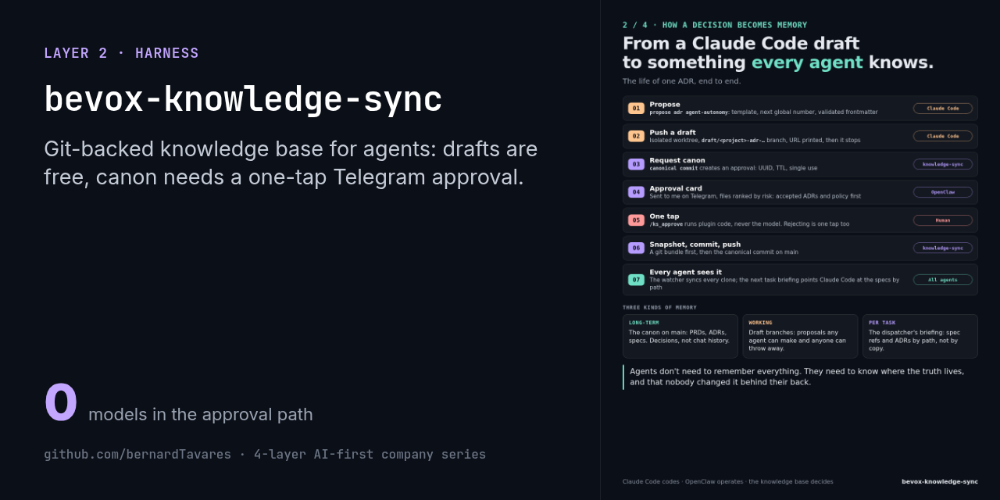
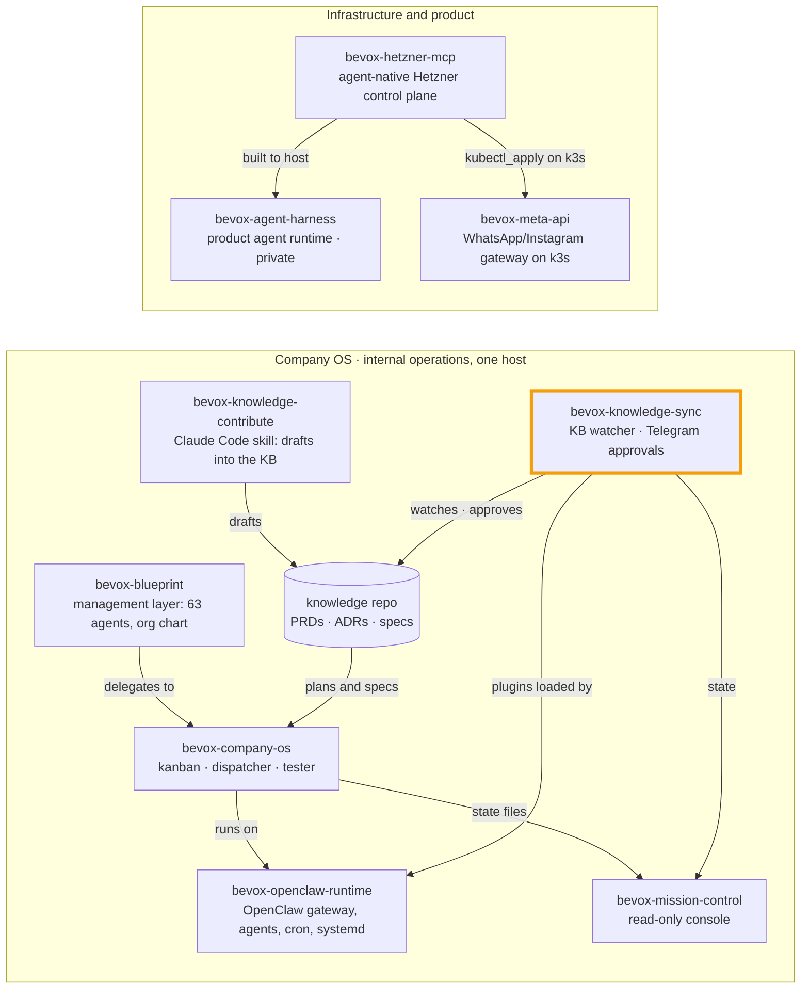

# Bevox Knowledge Sync

[](#) [](./LICENSE.md)  



> Part of the [4-layer AI-first company series](https://github.com/bernardTavares) ([how the repos fit together](#how-the-repos-fit-together)). License: FSL-1.1-MIT (source-available, converts to MIT after 2 years)

A governed, git-backed **knowledge spine for AI agents**. It is designed so that every agent at Bevox reads the same canonical knowledge repo: PRDs, ADRs, specs and the roadmap. Agents can write freely to `draft/*` branches. Anything canonical needs a **one-tap human approval on Telegram**, and that approval runs deterministically, with no LLM in the path.

This repo has two parts:
- **the skill** that watches the knowledge clone, acts on it and snapshots it;
- **four OpenClaw plugins** that turn approvals and escalations into Telegram slash commands.

It is part of the [Bevox Company OS](https://github.com/bernardTavares/bevox-company-os), and its state shows up in [Mission Control](https://github.com/bernardTavares/bevox-mission-control). The Claude Code side, the skill that writes PRDs, ADRs and specs into the knowledge repo as drafts, is [bevox-knowledge-contribute](https://github.com/bernardTavares/bevox-knowledge-contribute).

> **Status:** shipped internally on one host (systemd timers plus an OpenClaw skill and plugins). The knowledge repo it governed is private and is not included here.

## Why

Agents forget, contradict each other and drift from decisions. The rule, recorded as an ADR, was **one canonical knowledge repo that every agent consumes by reference**, with exactly one controlled and audited path for changing it. This repo enforces that rule.

## What's inside

### The skill (`skill/`, Bash)

| Part | What it does |
|---|---|
| **Watcher** | Read-only checks: fetch, ahead/behind, dirty tree, a merge or rebase in progress, stale drafts, conflict risk. It computes `health.overall` (`ok` / `degraded` / `critical`) from 11 issue codes and writes `state.json` atomically. It keeps `state.previous.json` for diffing and an append-only `events.jsonl`. |
| **Actions** | `pull-ff` is the **only** way to pull. Draft commit and push are automatic. Canonical commit, push and marker creation need approval. Destructive operations (`reset --hard`, force push, merge, rebase) are **not in the catalogue at all**. |
| **Approval engine** (`lib/approval.sh`) | Approval requests get a UUID and a TTL, and each can be used once. You can refer to one as `last`, by an 8-character prefix or by the full UUID. Failures come back as explicit codes: `not_found`, `ambiguous`, `expired`, `executed`, `rejected`. Each request is shown as a six-block approval card. |
| **Snapshots** | Git bundles taken hourly, before every canonical change, or by hand. They come with an index, a daily verify and a restore. |
| **Notifications** | Telegram messages with severity levels, deduplication, quiet hours and persistence. |

### The plugins (`plugins/`, Node)

All four register Telegram slash commands through the OpenClaw plugin SDK, so they run **deterministically, without the model**:

| Plugin | Commands |
|---|---|
| `knowledge-sync-commands` | `/ks_approve`, `/ks_reject`, `/ks_pending`, `/ks_status`, plus inline buttons on the approval card |
| `clarification-commands` | `/clr_pending`, `/clr_show`, `/clr_override`, `/clr_reject`, `/clr_redraft`, for the agent that escalates ambiguous tasks to a human |
| `unblock-commands` | `/unblock <task> pass\|cancel\|retry\|answer`, which resolves tasks the tester left inconclusive. Only allowlisted operators can use it. |
| `knowledge-commands` | `/review`, `/dismiss`, `/postpone`, `/accept`, `/retire`, `/keep`, `/keep-permanent`, for the watcher that finds documentation gaps and stale docs |

### Deploy discipline (`deploy/`)

The source (this repo) is kept apart from the runtime (`~/.openclaw/skills/knowledge-sync/`):
- `install-skill.sh` installs the skill;
- `smoke-bootstrap.sh` **proves** the installed copy is byte-equivalent to the source.

**Drift is a bug.**

## Running the tests

```bash
# Plugins (Node 22+), 113 tests
for p in clarification-commands knowledge-commands unblock-commands; do (cd plugins/$p && npm test); done

# Skill parser
bash skill/tests/canonical-files-parser.sh
```

To run it for real you need an OpenClaw gateway, a Telegram bot, and a knowledge repo cloned at `$KS_CLONE_PATH` (default `~/bevox-knowledge`). Set `KS_NOTIFY_TARGET` to your Telegram chat ID, and `OPENCLAW_GATEWAY_OPERATOR_IDS` to the IDs allowed to approve.

## How this was built

As one person, AI-native: a spec and plan for each epic, then Claude Code implementing with TDD. The docs and comments are in Portuguese. The command names, the code and this README are in English.

## How the repos fit together

This repo is one piece of Bevox's public code. The repos form two systems: the **Company OS**, which ran Bevox's internal operations on one host on top of OpenClaw, and the **infrastructure** the product was built to run on.



| Repo | Role | Runs with |
|---|---|---|
| [bevox-openclaw-runtime](https://github.com/bernardTavares/bevox-openclaw-runtime) | OpenClaw gateway config, agents (Vox + local Qwen), cron jobs, systemd units | everything in the Company OS runs on it |
| [bevox-company-os](https://github.com/bernardTavares/bevox-company-os) | Supervised agents: plan → kanban → headless Claude Code → tester → Telegram | runtime, mission-control, knowledge-sync |
| [bevox-mission-control](https://github.com/bernardTavares/bevox-mission-control) | Read-only web console over the Company OS state (fork of TenacitOS) | company-os, knowledge-sync |
| [bevox-knowledge-sync](https://github.com/bernardTavares/bevox-knowledge-sync) | Knowledge-repo watcher + OpenClaw plugins for approvals on Telegram | runtime, knowledge-contribute |
| [bevox-knowledge-contribute](https://github.com/bernardTavares/bevox-knowledge-contribute) | Claude Code skill that writes PRDs, ADRs and specs as draft branches | knowledge-sync |
| [bevox-blueprint](https://github.com/bernardTavares/bevox-blueprint) | Management layer: 63 Claude Code agents, org chart, RACI, OKRs | company-os |
| [bevox-hetzner-mcp](https://github.com/bernardTavares/bevox-hetzner-mcp) | MCP server + REST control plane for Hetzner Cloud with an approval gate | built to host the agent harness; manages meta-api's k3s |
| [bevox-meta-api](https://github.com/bernardTavares/bevox-meta-api) | Multi-tenant WhatsApp/Instagram gateway that ran in production on k3s | hetzner-mcp |
| bevox-agent-harness (private for now) | The product's agent runtime. It never carried production traffic. | hetzner-mcp |

## License

[Functional Source License 1.1, MIT Future License](./LICENSE.md) (FSL-1.1-MIT). Copyright 2026 Bernard Tavares.

You may use, modify and redistribute it for any purpose except a competing commercial product or service. Each version becomes MIT-licensed two years after its release.
